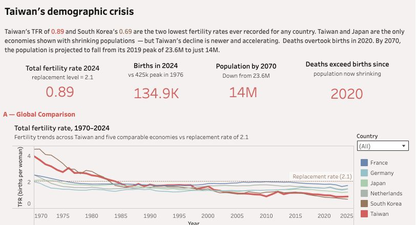

# Taiwan’s Demographic Crisis

### An interactive Tableau data storytelling project

This project explores Taiwan’s demographic changes through fertility rates, births and deaths, population trends, and international comparisons. The Tableau story places these trends in a wider economic and social context.

**[Explore the interactive dashboard on Tableau Public](https://public.tableau.com/views/Taiwansdemographiccrisis/Taiwansdemographiccrisis)**

## Dashboard Preview

*Click the image to explore the interactive dashboard.*

## Project Overview

Taiwan’s changing population raises questions about its future population size and the pressures facing its economy and society. This Tableau project combines historical trends, comparisons with selected economies, and a population projection in a visual story.

## Project Objectives

- Explore long-term fertility and population trends in Taiwan.
- Compare Taiwan with Japan, South Korea, France, Germany, and the Netherlands.
- Show the relationship between births, deaths, and natural population change.
- Present historical population figures alongside future projections.
- Communicate demographic issues through an accessible interactive story.

## Dashboard Story

### 1. Taiwan Is in Crisis

The overview compares fertility and population growth across six economies, charts Taiwan’s births and deaths, and shows its historical and projected population.

### 2. Economic Pressure

This section explores economic pressures associated with demographic change.

### 3. Social Collapse

This section considers social challenges associated with demographic change.

### 4. Consequences

This section presents potential longer-term consequences of demographic change.

## Key Insights

- **Fertility has declined over time.** The dashboard compares Taiwan’s trend with five other economies and includes a replacement-level reference.
- **Deaths exceeded births from 2020.** This marked a shift toward natural population decrease.
- **Population outcomes differ across economies.** Births, deaths, and net migration all contribute to total population change.
- **The population outlook is significant.** The dashboard shows a historical peak of approximately 23.6 million in 2019 and a projection of approximately 14 million by 2070. Projections are conditional estimates, not guaranteed outcomes.

## Data Sources

The project brings together publicly available demographic and socioeconomic data from multiple sources. The analysis draws primarily on:

- **OECD data:** International indicators used to compare demographic and socioeconomic trends across selected economies.
- **Taiwan government open data:** Local statistics used to examine Taiwan’s population and demographic trends.
- **Other public sources:** Additional datasets used to provide context and support the analysis.

Datasets cover different periods and may use different definitions or collection methods. Individual dataset links and projection assumptions can be added as they are identified.

## Data Features

| Feature | Description |
| --- | --- |
| Year | The year associated with an observation or projection. |
| Country or economy | Taiwan or one of the selected comparison economies. |
| Total fertility rate | A measure of births per woman used to compare fertility trends. |
| Population growth rate | Annual change in total population, expressed as a percentage. |
| Births and deaths | The numbers of live births and deaths recorded in a year. |
| Population | Historical or projected number of people in Taiwan. |
| Historical or projected | Identifies whether a population value is observed or projected. |

## Tools and Skills

- **Tableau and Tableau Public:** Dashboard design, interactive visualization, and publishing.
- **Analysis:** Time-series comparison, demographic indicators, and interpretation of projections.
- **Communication:** Chart design, visual storytelling, and public-facing documentation.

## How to Explore

1. Open the [Tableau Public dashboard](https://public.tableau.com/views/Taiwansdemographiccrisis/Taiwansdemographiccrisis).
2. Start with **Taiwan Is in Crisis** and explore the country comparison.
3. Review the births-and-deaths crossover and the population projection.
4. Navigate through the remaining story themes for the broader context.

## Limitations

The dashboard describes patterns and comparisons; it does not establish their causes. Projection values depend on assumptions about future fertility, mortality, and migration. Natural change is births minus deaths, while total population change also includes net migration. Comparisons are limited to the economies and periods displayed.

